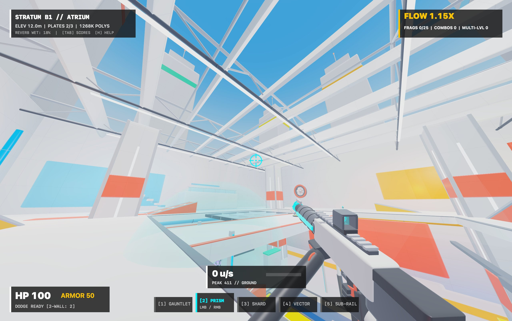

# Sublevel — Technical & Design Specification (Swift & Metal)



> **Concept:** A hyper-kinetic, textureless 3D arena shooter built natively for macOS with **Swift** and **Metal**, where **Mirror's Edge** architectural color-blocking meets the movement physics of **Quake III Arena** and the dual-mode weaponry & dodge mechanics of **Unreal Tournament '99**.
> **The Pun ("Sublevel"):** Rather than traditional RPG "leveling up" via stat bloat, progression happens by descending through stark, brutalist underground architectural strata (*Sublevels*) and mastering spatial elevation, momentum, and verticality within each arena.

---

## 1. Core Pillars

1. **Pure Chromatic Readability (Mirror's Edge):** Zero bitmap photo-textures. Surfaces are defined by procedural smoothness/roughness values, stark white architectural concrete, multi-light radiosity color bleeding, geometric edge bevels, and saturated functional color coding.
2. **Momentum Mastery (Quake 3):** Uncapped horizontal air-acceleration, strafe-jumping, bunny-hopping, rocket-jumping, stair-stepping, and ramp trimping.
3. **Tactical Reactivity (UT99):** Double-tap directional ground dodges, airborne wall-dodges, and high-skill alt-fire weapon combos (e.g., Prism Shock Orb + Beam detonation).
4. **Vertical Descent & Elevation ("Sublevel"):** Arenas are stacked vertically (`B1` -> `B2` -> `B3`). Knockback, jump pads, hydraulic lifts, and destructible floor/skylight grates drop or launch combatants between sub-strata mid-fight.

---

## 2. Visual & Rendering Architecture (Metal & MetalKit)

### 2.1 Textureless Procedural Material & Mesh Pipeline
All arena architecture, robot silhouettes, weapons, and VFX are generated procedurally in Swift and rendered via hardware-instanced **Metal** draw calls (`MetalRenderer.swift`) with zero external texture assets:
- **11 High-Polygon Procedural Primitives:** Watertight SDF-rounded architectural blocks, beveled cubes, subdivided sloped launch wedges, 40-segment chamfered cylinders, hollow gun-barrel tubes, tori, tapered cones, faceted crystal octahedra, spheres, and a sky dome — pushing **500K–1.2M+ triangles** per frame.
- **Unified Metal Shader (`sublevel_vertex` / `sublevel_fragment`):** Driven per-instance via `GPUInstanceData` across six shading modes:
  - `Mode 0` — *Mirror's Edge* architectural surface: 3D procedural micro-normal noise, crisp SDF bevel highlights, sky Fresnel, and radiosity bounce.
  - `Mode 1` — High-contrast opponent armor with unshaded Fresnel silhouette rim lighting.
  - `Mode 2` — Volumetric energy field & Fresnel shockwave distortion (Shock Combos & explosions).
  - `Mode 3` — Pure radiant emissive neon, plasma cores, volumetric laser beams, and holographic reticles.
  - `Mode 4` — Precision machined hardware, brushed steel, dark polymer, and translucent holo-glass.
  - `Mode 5` — Procedural *City of Glass* cerulean-to-horizon sky dome and solar halo.
- **Exact Adjugate Normals:** Vertex shader computes inverse-transpose normals analytically so non-uniformly scaled wedges and chamfered slabs retain accurate lighting.

### 2.2 Color Semantic Language ("Sublevel Vision")
Defined in `SublevelPalette` (`MathAndColor.swift`), every color in the arena carries immediate gameplay meaning:
| Swatch | Hex | Gameplay Meaning |
| :--- | :--- | :--- |
| **Stark White / Warm Gray** | `#F7F9FC` / `#C7CFDB` | Neutral static geometry, floors, mega-columns, walls |
| **Signal Red / Runner Orange** | `#FF2216` / `#FF6B0A` | Kinetic flow: Jump pads, wall-dodge panels, launch ramps |
| **Cobalt Blue / Sky Cerulean** | `#005DFF` / `#3DA3FF` | Vertical transitions: Drop shafts, teleporters, lifts, skylights |
| **Amber Gold** | `#FFB800` | High-tier pickups: Mega-Health, Armor Shards, Quad Overdrive |
| **Acid Magenta / Electric Cyan** | `#FF007A` / `#00F0FF` | Opponent silhouettes & Prism energy accents |

### 2.3 Lighting, MSAA & Multi-Pass Frame Encoding
- **Target Frame Rate:** `120 FPS` (`4x MSAA`, `bgra8Unorm` color + `depth32Float` depth) with triple-buffered dynamic instance rings.
- **Dynamic Radiosity (`GPUSceneUniforms`):** Up to **32 active `GPUPointLight` sources** combine static colored architectural bounce lights with dynamic illumination from flying plasma projectiles and expanding Shock Combo spheres.
- **High-Key Tonemapping:** Custom `tonemapMirrorsEdge` curve preserves crisp expansion joints on sunlit white slabs while boosting primary color saturation.
- **4-Stage Render Pass (`encodeWorldAndViewmodel`):**
  1. **Sky Dome Pass:** Depth-disabled luminous *City of Glass* sky gradient and sun disc.
  2. **Opaque Pass:** Pre-built static GPU world buffers + dynamic lifts, shuttles, turbines, louvers, debris shards, and 4-archetype bots.
  3. **Translucent Pass:** Alpha-blended glass balustrades, skylight plates, sunbeam shafts, portals, twin-core beams, and Shock Spheres.
  4. **First-Person Viewmodel Pass:** Depth-scaled `75° FOV` pass rendering articulated Runner gloves and mechanical firearms that inherit nearby world radiosity color-bleed without clipping into walls.

---

## 3. Movement Physics Architecture (`MovementSolver`)

Implemented in pure value-type SIMD math (`MovementSolver.swift`), bypassing damped platformer physics in favor of **id Tech 3 (`PM_Accelerate`) + CPMA air control + UT99 Dodge** mechanics.

### 3.1 Core Kinematic Constants
```swift
// Sources/Sublevel/MovementSolver.swift
public struct MovementConfig: Sendable {
    // Ground Movement
    public var maxGroundSpeed: Float = 10.5      // m/s (~320 u/s equivalent)
    public var groundAccel: Float = 12.0
    public var friction: Float = 6.0
    public var stopSpeed: Float = 3.2

    // Air / Quake 3 Physics
    public var maxAirWishSpeed: Float = 1.25     // Low wish-speed cap enables Q3 strafe-jumping
    public var airAccel: Float = 2.5
    public var cpmAirControl: Float = 150.0      // CPMA W-only air turning
    public var gravity: Float = 24.0
    public var jumpImpulse: Float = 8.8          // Auto-hop on hold

    // UT99 Dodge & Wall Tech
    public var dodgeImpulseHorizontal: Float = 13.5
    public var dodgeImpulseVertical: Float = 5.2
    public var dodgeCooldown: Float = 0.35
    public var wallDodgeMaxCount: Int = 2
    public var slideFrictionMultiplier: Float = 0.15
}
```

### 3.2 Physics Tick Pipeline (`MovementSolver.step`)
1. **Input Sampling & Jump Buffer:** Captures wish direction (`MovementInput`), `0.10s` jump buffer window, and double-tap or dedicated dodge requests.
2. **Ground Check & Auto-Hop:** When grounded with jump held or buffered, applies vertical `jumpImpulse` immediately and skips ground friction on that frame — preserving 100% horizontal bunny-hop momentum.
3. **Quake 3 Ground & Air Acceleration:**
   ```swift
   public static func accelerate(
       velocity: inout SIMD3<Float>,
       wishDir: SIMD3<Float>,
       wishSpeed: Float,
       accel: Float,
       delta: Float,
       baseScaleSpeed: Float? = nil
   ) {
       let currentSpeed = simd_dot(velocity, wishDir)
       let addSpeed = wishSpeed - currentSpeed
       guard addSpeed > 0 else { return }
       let scaleSpeed = baseScaleSpeed ?? wishSpeed
       let accelSpeed = min(accel * delta * scaleSpeed, addSpeed)
       velocity += wishDir * accelSpeed
   }
   ```
4. **UT99 Dodge & Wall-Dodge:**
   - **Ground Dodge:** Instant horizontal burst (`13.5 m/s`) + low vertical hop (`5.2 m/s`) on double-tapping `W/A/S/D` or pressing `Shift`/`V`.
   - **Wall Dodge:** Up to `2` airborne wall-dodges per jump when near walls or kinetic panels, kicking velocity away from the wall normal across vertical shafts.
5. **Sublevel Slam & Crouch-Slide:** Holding crouch (`C` / `Ctrl`) mid-air multiplies gravity by `2.2x` to dive through breached sublevels; holding crouch on the floor at high speed engages a `0.15x`-friction slide.
6. **Stair Stepping, Ramp Trimping & Moving Platforms:** Steps cleanly up `0.45m` ledges without losing speed, launches vertically off sloped wedges (`rampPosX`/`NegX`/`PosZ`/`NegZ`), and inherits carrier velocity from moving hydraulic lifts and aerial shuttles.

---

## 4. Weapon & Arsenal System (UT99 Dual-Mode + Q3 Trinity)

Defined in `WeaponArsenal.swift` (`WeaponSlot` & `WeaponSystem`) with detailed multi-part 3D viewmodels and articulated Runner hands (`CharacterModels.swift`). Every weapon pairs **Primary Fire**, **Alt-Fire**, and a **Movement / Cross-Mode Synergy**:

| Weapon | Color Accent | Primary Fire | Alt-Fire | Synergy / Combo |
| :--- | :--- | :--- | :--- | :--- |
| **1. Kinetic Gauntlet** | Signal Red | High-knockback melee dash | Focused air-blast impulse cone | Blast floors for zero-self-damage vertical hops or knock foes into the Sump abyss |
| **2. Prism Rifle** *(Shock Rifle)* | Electric Cyan | Instant hitscan beam (45 dmg) | Slow unstable Shock Orb (55 dmg) | **Shock Combo:** Detonate the Alt-Fire Orb with the Primary Beam for a `160-dmg`, `7.8m` sphere blast |
| **3. Shard Cannon** *(Flak Cannon)* | Amber Orange | 9-pellet ricocheting shrapnel spread | Arcing fragmentation grenade | Pellets bounce off brutalist walls with glowing orange tracers |
| **4. Vector Launcher** *(Rocket)* | Crimson | Fast linear rocket (100 dmg, splash) | Hold to charge up to 3 spiral/spread rockets | Core rocket-jumping weapon with `0.4x` reduced self-damage |
| **5. Sub-Rail** *(Railgun / Sniper)* | Cobalt Violet | Piercing 90-dmg slug + volumetric beam | Scope zoom + high-velocity penetrator | Pierces destructible sublevel plates and rewards mid-air flicks |

---

## 5. Arena Strata, Opponents & Procedural Audio

### 5.1 Stratified Arena (`SL_ATRIUM`) & Dynamic Structures
Built in `ArenaWorld.swift` and `ArenaArchitecture.swift`:
- **B1 — Atrium / Skylight (`Y >= 11.0m`):** Sunlit white concrete, space-frame roof trusses, sun-tracking louvers, *City of Glass* exterior skyscrapers & tower crane, long Sub-Rail sightlines.
- **B2 — Concourse (`-0.5m <= Y < 11.0m`):** Signal Red & Runner Orange kinetic corridors, wall-dodge shafts, counter-phased hydraulic lifts, and aerial monorail shuttles.
- **B3 — The Sump / Core (`Y < -0.5m`):** Saturated Cobalt Blue & Amber Gold reactor rings, reciprocating abyss pistons, spinning extraction turbines, and high-tier powerups (`Quad Overdrive`, `Sub-Shield`) suspended above the `-18.5m` lethal abyss.
- **Dynamic Breaches:** Destructible glass skylights and concrete floor plates (`shatterFloor`) fracture under Shock Combos, Rockets, or Sub-Rail slugs, spawning 20+ tumbling 3D `DebrisShard`s and opening new vertical drop-downs mid-match.

### 5.2 Distinct Opponent Chassis (`BotChassis`)
Four autonomous arena bots (`BotAndGameSimulation.swift`) with unique silhouettes and hitboxes:
- **VEX — Striker Biped:** Reverse-jointed agile pursuit android.
- **TITAN — Heavy Juggernaut:** Broad-shouldered siege mech with missile pauldrons and heavy armor.
- **WIDOW — Arachnid Strider:** Quad-legged spider skirmisher chassis.
- **HALO — Hover Seraph:** Levitating polyhedral sentinel framed by counter-rotating gyroscopic rings.

### 5.3 Momentum HUD & Procedural Synth Audio
- **Diegetic HUD (`SublevelHUDOverlayView`):** Displays real-time horizontal speed (`u/s`) & peak velocity bar, **Sublevel Flow Multiplier** (scaling damage up to `+50%` from airtime, breaches, Shock Combos, and multi-stratum kills), stratum elevation/plate telemetry, weapon bar, and scoreboard.
- **Procedural Audio (`AudioSynthEngine`):** Zero audio files — synthesizes footsteps, jumps, wall-dodges, jump pads, weapon reports, Shock Combos, glass breaches, and hit markers in real time via `AVAudioEngine`, dynamically adjusting `AVAudioUnitReverb` wet mix by depth (`18%` in B1 -> `34%` in B2 -> `55%` in B3).

---

## 6. Project Structure (Swift Package + macOS App Bundle)

```text
sublevel/
├── Package.swift                        # SwiftPM manifest (macOS 14+, Metal, MetalKit, AppKit, AVFoundation, Network, GameController)
├── Makefile                             # Builds release binary, exports AppIcon.icns, signs Sublevel.app, runs XCTest
├── AppIcon.icns                         # Procedurally generated brutalist strata macOS app icon
├── screenshot.jpg                       # In-game SL_ATRIUM preview
├── Sources/
│   └── Sublevel/
│       ├── main.swift                   # AppKit lifecycle, window/menu setup, CLI flags (--export-iconset, --self-test-metal)
│       ├── MathAndColor.swift           # SublevelPalette, Stratum definitions, SIMD matrix transforms & ray-AABB math
│       ├── MovementSolver.swift         # MovementConfig, WorldBoxCollider, KinematicState, Q3/UT99 physics & ramp/stair solver
│       ├── ArenaWorld.swift             # SL_ATRIUM map layout, jump pads, teleporters, pickups, dynamic movers, shatter breaches
│       ├── ArenaArchitecture.swift      # High-polygon static & dynamic City of Glass procedural geometry batches
│       ├── CharacterModels.swift        # PartMaterial, ModelBatch, 4 bot chassis rigs, mechanical 3D firearms & Runner hands
│       ├── WeaponArsenal.swift          # 5 dual-mode weapons, hitscan beams, Shock Combo detonation, projectiles & splash math
│       ├── BotAndGameSimulation.swift   # SublevelSimulation loop, bot AI, Flow Multiplier, camera FX, 60Hz NetworkTickSnapshot ring
│       ├── MetalRenderer.swift          # 4x MSAA MTKView renderer, 11 procedural mesh primitives, triple-buffered instancing, MSL shaders
│       ├── AudioSynthEngine.swift       # Real-time AVAudioEngine procedural sound synthesis & B1/B2/B3 stratum reverb
│       └── HUDAndApp.swift              # SublevelGameView mouse-capture/double-tap dodge input & CoreGraphics HUD overlay
└── Tests/
    └── SublevelTests/
        └── SublevelTests.swift          # Unit & GPU tests for Q3 physics, dodges, Shock Combos, lifts, models, and Metal snapshots
```

---

## 7. Runtime & Rendering Architecture

```text
NSApplication
└── SublevelAppDelegate (main.swift)
    ├── SublevelSimulation (BotAndGameSimulation.swift)
    │   ├── ArenaMap (Colliders, DynamicMovers, JumpPads, Teleporters, Pickups, Breaches)
    │   ├── Player KinematicState + CameraFXState (FOV scaling, strafe roll, landing punch, recoil)
    │   ├── ArenaBots [4 distinct BotChassis] + Projectiles + Beams + ShockSpheres + DebrisShards
    │   └── NetworkTickSnapshot Ring Buffer (60Hz deterministic state history)
    ├── AudioSynthEngine (AVAudioEngine -> AVAudioPlayerNode -> AVAudioUnitReverb [B1/B2/B3])
    └── NSWindow
        └── SublevelGameView (MTKView — 120 FPS, 4x MSAA, Mouse Capture & Double-Tap Dodge Input)
            ├── MetalArenaRenderer (MTKViewDelegate)
            │   ├── Pass 0: Procedural Sky Dome (Shader Mode 5)
            │   ├── Pass 1: Static Cached + Dynamic Opaque Instanced Batches (Modes 0, 1, 3, 4)
            │   ├── Pass 2: Translucent Glass, Sunbeams, Portals, Beams & Shock Spheres (Modes 2, 3, 4)
            │   └── Pass 3: Depth-Scaled 75° FOV Viewmodel (Runner Hands + Active Weapon + Room Bounce Lights)
            └── SublevelHUDOverlayView (CoreGraphics Crosshair, Speedometer u/s, Flow Meter, Scoreboard)
```

---

## 8. Build, Run & Controls

### Build & Test Commands
```bash
# Build release binary, generate AppIcon.icns, and bundle Sublevel.app
make app

# Build and launch Sublevel.app
make run

# Run the movement, weapon combo, breach, lift, and Metal snapshot test suite
make test

# Headless Metal shader & polygon pipeline verification
swift run Sublevel --self-test-metal
```

### Controls
| Input | Action |
| :--- | :--- |
| **Click Window** | Capture mouse cursor for 3D arena look |
| **W / A / S / D** *(or Arrow Keys)* | Ground movement & airborne strafe-jumping |
| **Double-Tap W / A / S / D** *(or **Shift** / **V**)* | UT99 Ground Dodge or Airborne Wall-Dodge (up to 2x off walls) |
| **Space (Hold)** | Jump / Auto-Hop (skips ground friction on landing frame) |
| **C / Left Ctrl** | Crouch-Slide (on floor at speed) or **Sublevel Slam** (`2.2x` gravity dive in mid-air) |
| **Left Click** | Primary Fire |
| **Right Click** *(or **E**)* | Alt-Fire (Air-Blast, Shock Orb, Flak Grenade, 3-Rocket Charge, Sub-Rail Zoom) |
| **1 – 5 / Q / Scroll Wheel** | Switch Weapon (Gauntlet, Prism Rifle, Shard Cannon, Vector Launcher, Sub-Rail) |
| **B** | Toggle Arena Bots |
| **R** | Reset Match & Restore Dynamic Breaches |
| **M** | Mute / Unmute Procedural Synth Audio |
| **Tab (Hold)** | Show Scoreboard (frags, deaths, K/D, bot standings) |
| **H** | Toggle Help Overlay |
| **ESC** | Release Mouse Capture |

---

## 9. Possible Future Improvements

1. **Online / LAN Rollback Multiplayer (`Network.framework`):** Build on the existing 60Hz `NetworkTickSnapshot` ring buffer and linked `Network` framework to add low-latency UDP client-server multiplayer, client-side movement prediction, lag-compensated hitscan rewind, and synchronized breach destruction.
2. **Advanced Metal Post-Processing & Shadow Mapping:** Upgrade the forward MSAA pass to an `rgba16Float` HDR render graph with cascaded directional shadow maps through the B1 skylight louvers, compute-shader mipmap bloom, screen-space ambient occlusion (SSAO), and screen-space reflections on polished concrete.
3. **3D Spatial HRTF Audio & Dynamic Synth Soundtrack:** Migrate `AudioSynthEngine` from stereo buffers to `AVAudioEnvironmentNode` 3D positional audio (vertical occlusion across strata, directional enemy footsteps, Doppler projectiles) paired with a procedural *Mirror's Edge*-inspired ambient synth stem system driven by the Sublevel Flow Multiplier.
4. **Native Controller Support & Input Remapping (`GameController`):** Wire up the linked `GameController` framework for DualSense / Xbox gamepads (gyro flick-aiming, adaptive trigger resistance for Vector rocket charging, haptics) alongside persistent settings for sensitivity, FOV, and custom keybinds.
5. **Multi-Arena Rotation, Map Importer & New Modes:** Expand beyond `SL_ATRIUM` with new vertical maps (`SL_REACTOR`, `SL_TRANSIT`), add a TrenchBroom `.map` or JSON brush loader alongside procedural architecture, and introduce **Instagib Sub-Rail**, **Capture the Core**, and **Sublevel Time-Trial** speedrun modes.
6. **Volumetric Bot Navigation & Vertical Combat AI:** Teach arena bots 3D jump-link navigation across `B1`–`B3` jump pads and lifts, intentional rocket-jumping, projectile trajectory leading, and deliberate Shock Orb + Beam combo detonate timing.
7. **Metal-Accelerated HUD & Deterministic Replay Viewer:** Move `SublevelHUDOverlayView` from CPU CoreGraphics into a GPU-instanced Metal glyph/vector overlay for zero-overhead 240Hz ProMotion rendering, and serialize input streams + tick snapshots for match replays and ghost races.

